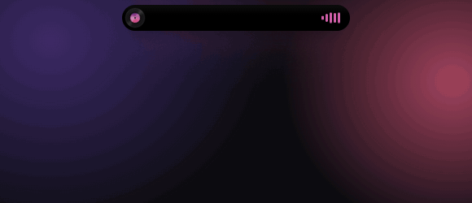
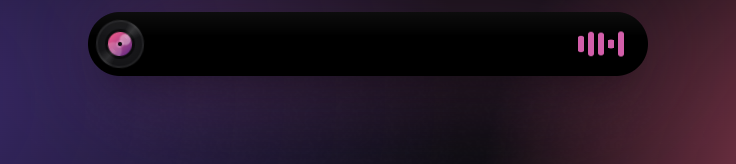
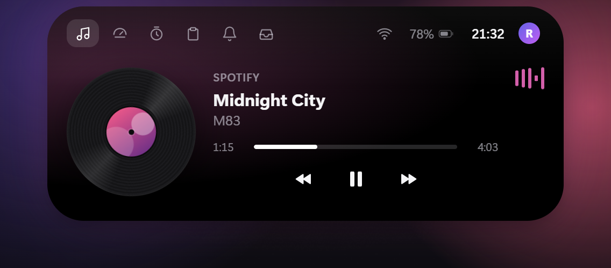
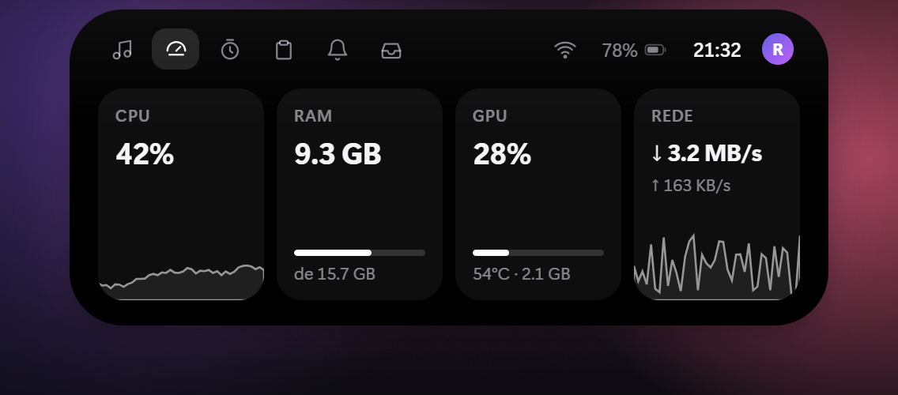
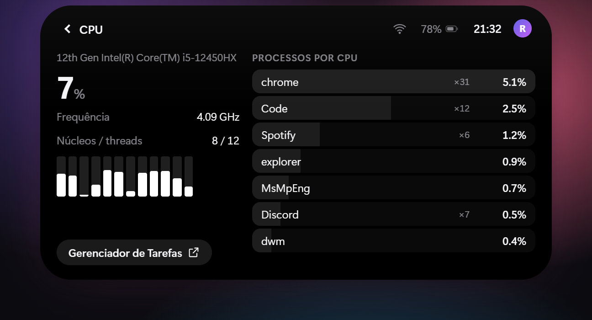
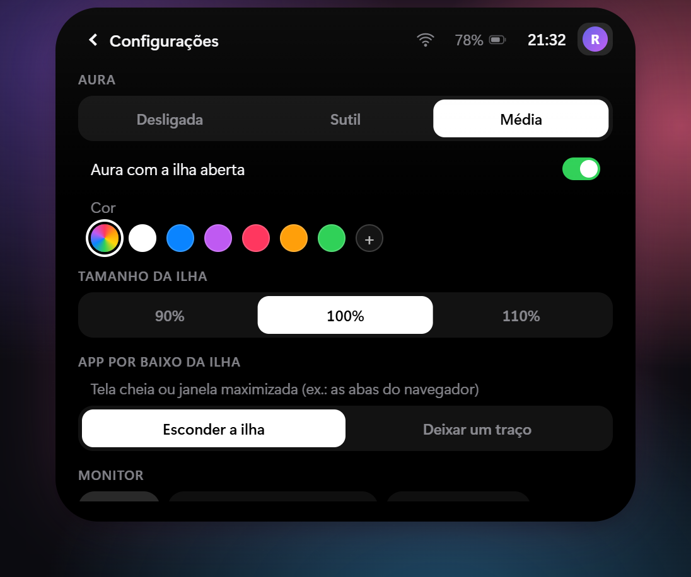
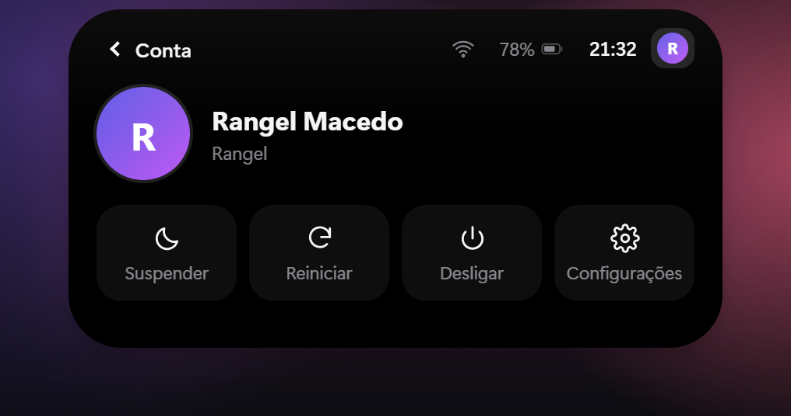
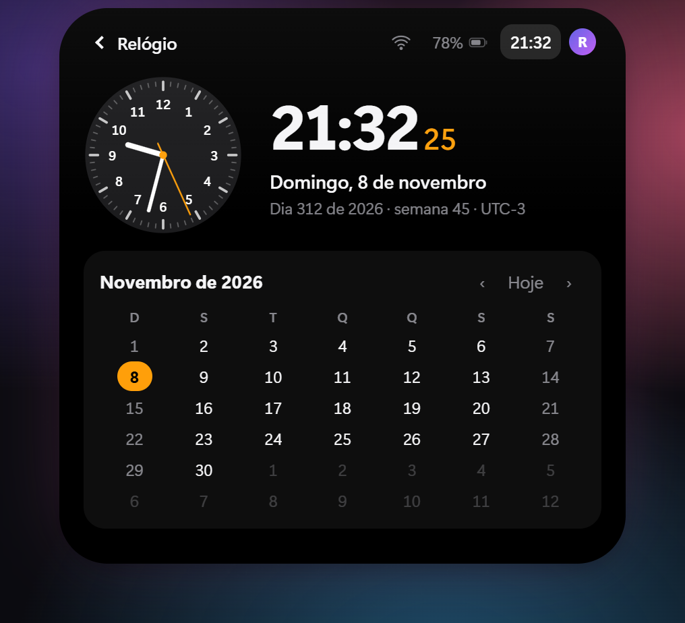
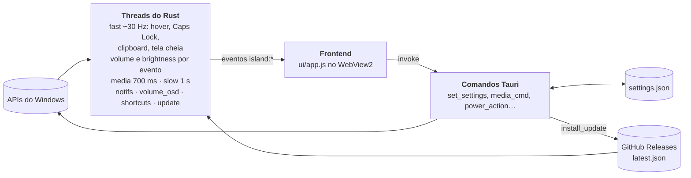

# Island 🏝️

Dynamic Island para Windows 11: uma pílula preta no topo da tela que se transforma com animação de mola, mostra o que está acontecendo no PC e abre num painel com mídia, sistema, foco, clipboard e muito mais.



## O que a ilha faz

| Estado | Quando aparece |
|---|---|
| Mídia | música tocando (Spotify, YouTube no navegador, qualquer player do Windows): vinil girando com a capa no rótulo + equalizador na cor da capa |
| Notificações | notificações de outros apps (WhatsApp, Teams, Outlook…) aparecem na ilha e ficam na aba Notificações; dá para silenciar por app |
| Nova faixa | anúncio de 2,5 s com capa, título e artista |
| Volume | ao mudar o volume ou o mudo; o aviso de volume nativo do Windows some para não duplicar (veja [Limitações conhecidas](#limitações-conhecidas)) |
| Brilho | ao mudar o brilho da tela interna do notebook |
| Toasts | Caps Lock, carregador conectado/desconectado, bateria fraca (20/10/5%), internet caiu/voltou, texto copiado |
| Pomodoro | anel + contagem compacta enquanto roda |
| Expandido (mouse em cima) | abas **Mídia**, **Sistema** (CPU, RAM, GPU NVIDIA, rede), **Foco**, **Clipboard** (histórico, clique para recopiar), **Notificações** e **Estante** (arraste arquivos até a ilha) |

### Painéis (clique dentro da ilha expandida)

- **Cards de Sistema** → detalhe do componente: CPU (modelo, frequência, uso por núcleo), RAM (disponível, paginação), GPU (temperatura, consumo, clock, ventoinha, VRAM) e Rede (interfaces, IPs, tráfego), com os processos que mais usam cada um e atalho para o Gerenciador de Tarefas.
- **Wi-Fi** → redes ao redor com sinal; um clique conecta nas redes salvas, redes novas abrem o painel de senha do Windows.
- **Bateria** → carga, tempo restante, modo de energia (Eficiência / Equilibrado / Desempenho), plano de energia e atalho para a economia de energia.
- **Relógio** → relógio analógico com ponteiro de segundos suave, hora com segundos e calendário do mês.
- **Conta** (clique no avatar) → foto e nome da conta do Windows, com **Suspender**, **Reiniciar** e **Desligar** (os dois últimos pedem confirmação) e atalho para as Configurações.
- **Configurações** (pela Conta ou pelo item da bandeja) → tudo abaixo, sem sair da ilha.

### Configurações

- **Aura**: intensidade (Desligada, Sutil ou Média), se aparece com a ilha aberta e a cor: automática (a cor da capa do álbum), **Sistema** (a cor de destaque do Windows, que acompanha na hora quando você a troca nas Configurações do Windows), predefinidas ou um seletor de matiz.
- **Tamanho da ilha**: 90%, 100% ou 110%.
- **App por baixo da ilha**: quando há um app em tela cheia ou uma janela maximizada por baixo da ilha (por exemplo, as abas do navegador), a ilha some e fica invisível, mas dá para puxá-la deixando o mouse parado na borda de cima da tela. Se preferir, escolha **Deixar um traço** no lugar.
- **Monitor**: em qual tela a ilha aparece.
- **Atalhos globais**, regraváveis: `Ctrl+Alt+I` abre/fecha a ilha, `Ctrl+Alt+Espaço` dá play/pause e `Ctrl+Alt+P` inicia o pomodoro.
- **Avisos**: liga/desliga cada tipo (volume, brilho, Caps Lock, bateria, internet, nova música, texto copiado, notificações, som do pomodoro) e silencia notificações app por app.
- **Esconder o aviso de volume do Windows**: ligado por padrão (só vale com o aviso de Volume ligado).

Fora da pílula os cliques atravessam a janela. A ilha some sozinha em jogo, vídeo em tela cheia ou apresentação. O ícone na bandeja tem **Configurações**, **Iniciar com o Windows**, **Recentralizar**, **Recarregar visual**, **Procurar atualizações** e **Sair**. **Iniciar com o Windows** vem ligado: o Island ativa sozinho na primeira execução e, se você desligar pela bandeja, a escolha vale também nas atualizações.

O Island se atualiza sozinho: procura versão nova ao iniciar e a cada 6 horas. Quando encontra, mostra um aviso (com as notas da versão) e um botão verde com a versão no topo da ilha expandida; um clique baixa, instala e reabre o app.

## Galeria

| | |
|---|---|
| <br>**Compacta**: vinil e equalizador na cor da capa | <br>**Mídia** |
| <br>**Sistema** | <br>**Detalhe da CPU**, com os processos que mais usam |
| <br>**Configurações** | <br>**Conta** |
| <br>**Relógio** | |

As imagens vêm do modo demo (veja [Ver o visual sem compilar](#ver-o-visual-sem-compilar)), com dados falsos.

## Arquitetura

Tauri 2 + Rust, com o WebView2 do sistema como interface. O frontend é JavaScript puro (`ui/`), sem dependências nem etapa de build. Threads do Rust leem o Windows e mandam eventos `island:*` para o frontend, que desenha tudo e chama comandos Tauri de volta.



- **Threads e eventos**: cada thread tem o seu ritmo e emite só o que mudou. Eventos: `island:hover`, `island:fast`, `island:media`, `island:art`, `island:slow`, `island:brightness`, `island:clip`, `island:covered`, `island:notif`, `island:update`, `island:shortcut`, `island:drag`/`island:drop`, entre outros.
- **Comandos Tauri**: o frontend chama o Rust para agir (controle de mídia, energia, Wi-Fi, abrir arquivos, ler e gravar configurações, instalar atualização). Todo comando tem resposta no modo demo (`demoInvoke` em `ui/app.js`).
- **Configurações**: `%APPDATA%\dev.r4nges.island\settings.json`, modelo em `src-tauri/src/settings.rs` (valores ausentes ganham o padrão e valores inválidos são corrigidos ao carregar). O mesmo padrão é espelhado em `DEFAULT_CFG` no `ui/app.js`.
- **Código do Windows**: tudo em `src-tauri/src/platform/win.rs`, com um `mock.rs` equivalente para compilar fora do Windows.
- **Pacote esparso**: dá ao Island identidade de pacote para ler as notificações de outros apps (veja [Notificações de outros apps](#notificações-de-outros-apps)).
- **Atualizador**: o plugin de atualização do Tauri consulta o `latest.json` publicado no Release do GitHub e confere a assinatura do instalador (veja [Publicar uma versão](#publicar-uma-versão)).

## Pré-requisitos (uma vez)

1. **Rust**: <https://rustup.rs> (aceite o padrão `x86_64-pc-windows-msvc`)
2. **Visual Studio Build Tools** com a carga “Desenvolvimento para desktop com C++”
   `winget install Microsoft.VisualStudio.2022.BuildTools --override "--wait --passive --add Microsoft.VisualStudio.Workload.VCTools --includeRecommended"`
3. **Node.js LTS**: `winget install OpenJS.NodeJS.LTS`
4. WebView2 já vem no Windows 11.

## Rodar e gerar o instalador

```powershell
cd island_windows
npm install
npm run dev      # abre a ilha em modo desenvolvimento
npm run build    # gera o instalador em src-tauri\target\release\bundle\nsis\
```

A primeira compilação demora alguns minutos; as próximas são rápidas.

O `npm run build` assina o instalador para a atualização automática, então precisa da chave privada nas variáveis de ambiente:

```powershell
$env:TAURI_SIGNING_PRIVATE_KEY = Get-Content -Raw "$HOME\.tauri\island.key"
$env:TAURI_SIGNING_PRIVATE_KEY_PASSWORD = Get-Content -Raw "$HOME\.tauri\island.key.password"
```

Sem a chave, compile com `npx tauri build --config '{\"bundle\":{\"createUpdaterArtifacts\":false}}'`.

## Publicar uma versão

1. Suba a versão em `src-tauri/tauri.conf.json`, `src-tauri/Cargo.toml`, `package.json` e `src-tauri/msix/AppxManifest.xml` (`X.Y.Z.0`).
2. Faça o commit e crie a tag: `git tag -a vX.Y.Z -m "notas da versão" && git push origin main vX.Y.Z`. A primeira linha das notas aparece no aviso de atualização do Island.
3. O CI compila, assina e cria o Release com o instalador, o `.sig` e o `latest.json`. Os Islands instalados encontram a versão nova em até 6 horas, ou na hora pelo menu da bandeja.

A chave privada fica em `~\.tauri\island.key` (com a senha em `island.key.password`) e nos secrets `TAURI_SIGNING_PRIVATE_KEY` e `TAURI_SIGNING_PRIVATE_KEY_PASSWORD` do repositório. **Guarde uma cópia:** sem ela não dá para publicar atualizações que os Islands já instalados aceitem.

## Ver o visual sem compilar

Abra `ui\index.html` no navegador: roda em modo demo com dados falsos.
Teclas: `V` volume, `M` mudo, `K` Caps Lock, `L` brilho, `C` copiar, `B` carregador, `W` Wi-Fi, `N` próxima faixa, `P` pomodoro, `D` soltar arquivos, `E` expandir, `T` notificação, `U` atualização disponível, `S` configurações, `O` abrir (como o atalho global), `F` simula um app por baixo da ilha, `Espaço` play/pause.

Parâmetros na URL: `?clean` esconde a dica; `?state=expanded&tab=<media|system|focus|clip|notif|shelf>&view=<cpu|ram|gpu|net|wifi|battery|clock|settings|user>` abre num estado fixo; `?seed=1` enche clipboard e estante; `?update` simula uma atualização pendente.

## Onde mexer

- `ui/style.css`: cores, fontes, raios, brilho (`--glow`).
- `ui/app.js`, objeto `SIZES`: tamanho de cada estado. Molas `sw`, `sh`, `sr`: rigidez/amortecimento (menos amortecimento = mais quique). A janela do app tem 760×500 (`src-tauri/tauri.conf.json`).
- `src-tauri/src/platform/win.rs`: leitura das APIs do Windows.
- `src-tauri/src/main.rs`: frequência de leitura e eventos.

## Notificações de outros apps

O Windows só entrega notificações de outros apps a programas com **identidade de pacote**. O Island usa um *pacote esparso* (`src-tauri/msix/AppxManifest.xml`): o instalador NSIS continua igual e, ao final, registra essa identidade apontando para a pasta instalada.

1. Ligue o **Modo de Desenvolvedor**: Configurações → Sistema → Para desenvolvedores (necessário porque o pacote não é assinado).
2. Instale (ou reinstale) o Island. Se o Modo de Desenvolvedor estava desligado na instalação, abra a aba Notificações e clique em **Ativar**: o Island registra e reinicia sozinho.
3. Na primeira vez, permita o acesso em Configurações → Privacidade → Notificações.

Dica: para não ver o aviso duas vezes, desligue os *banners* do app em Configurações → Sistema → Notificações e deixe só “Mostrar na central de notificações”; a ilha continua recebendo.

## Limitações conhecidas

- **Lista de Wi-Fi no Windows 11 24H2+** exige a permissão de Localização para apps de desktop (Configurações → Privacidade → Localização). A ilha avisa e abre a tela certa.
- **Economia de energia** não tem API pública para ligar/desligar; o botão abre a página do Windows. O modo de energia só tem efeito com o plano Equilibrado ativo.
- **VRAM por processo** não é informada pelo driver NVIDIA no Windows (modo WDDM), por isso aparece “—”.
- GPU só NVIDIA (via NVML); sem placa NVIDIA o card mostra “—”.
- **Brilho** só funciona na tela interna de notebook (a leitura é feita pelo WMI): monitores externos e desktops não mostram o HUD de brilho.
- **Aviso de brilho do Windows**: continua aparecendo junto do HUD de brilho da ilha (só o aviso de volume é escondido).
- **Aviso de volume do Windows**: o Island o esconde enquanto mostra o próprio HUD de volume, mas isso depende de detalhes internos e não documentados do shell do Windows (testado no Windows 11 build 26300). Uma atualização do Windows pode quebrar o truque; nesse caso o aviso nativo simplesmente volta a aparecer junto do HUD. Também pode piscar por um quadro antes de sumir. Dá para desligar em Configurações → Esconder o aviso de volume do Windows.

## Consumo

Tauri usa o WebView2 do sistema: espere algo entre 60 e 150 MB de RAM somando os processos do WebView2 e CPU perto de zero parado. As animações só rodam enquanto a pílula está mudando de forma.
