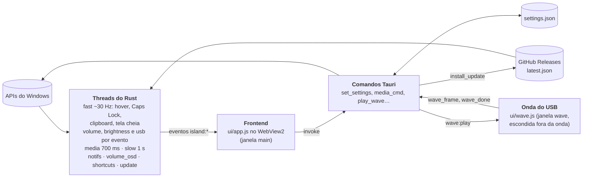

# RAD — R4nge's Awesome Desktop

*Tudo que o seu desktop faria se ele se achasse tão incrível quanto o nome sugere.*

Uma Dynamic Island para Windows 11 (com barra de tarefas de vidro, se você quiser): uma pílula preta que se transforma com animação de mola, mostra o que está acontecendo no PC e abre num painel com mídia, sistema, foco, clipboard e muito mais.


## O que a ilha faz

| Estado | Quando aparece |
|---|---|
| Mídia | música tocando (Spotify, YouTube no navegador, qualquer player do Windows): vinil girando com a capa no rótulo + equalizador na cor da capa |
| Notificações | notificações de outros apps (WhatsApp, Teams, Outlook…) aparecem na ilha e ficam na aba Notificações; dá para silenciar por app |
| Nova faixa | anúncio de 2,5 s com capa, título e artista |
| Volume | ao mudar o volume ou o mudo; o aviso de volume nativo do Windows some para não duplicar (veja [Limitações conhecidas](#limitações-conhecidas)) |
| Brilho | ao mudar o brilho da tela interna do notebook |
| Toasts | Caps Lock, carregador conectado/desconectado, bateria fraca (20/10/5%), internet caiu/voltou, texto copiado |
| USB conectado | ao plugar um pendrive, mouse, dock…: aviso com o nome do aparelho e uma onda de luz na cor da aura que sai da ilha e atravessa a tela; no anel, a tela "salta" como vidro (refração, leve aberração cromática e um brilho fino). Não toca com app em tela cheia |
| Pomodoro | anel + contagem compacta enquanto roda |
| Expandido (mouse em cima) | abas **Mídia**, **Sistema** (CPU, RAM, GPU NVIDIA, rede), **Foco**, **Clipboard** (histórico, clique para recopiar), **Notificações** e **Estante** (arraste arquivos até a ilha) |

### Painéis (clique dentro da ilha expandida)

- **Cards de Sistema** → detalhe do componente: CPU (modelo, frequência, uso por núcleo), RAM (disponível, paginação), GPU (temperatura, consumo, clock, ventoinha, VRAM) e Rede (interfaces, IPs, tráfego), com os processos que mais usam cada um e atalho para o Gerenciador de Tarefas.
- **Wi-Fi** → redes ao redor com sinal; um clique conecta nas redes salvas, redes novas abrem o painel de senha do Windows.
- **Bateria** → carga, tempo restante, modo de energia (Eficiência / Equilibrado / Desempenho), plano de energia e atalho para a economia de energia.
- **Relógio** → relógio analógico com ponteiro de segundos suave, hora com segundos e calendário do mês.
- **Conta** (clique no avatar) → foto e nome da conta do Windows, com **Suspender**, **Reiniciar** e **Desligar** (os dois últimos pedem confirmação) e atalho para as Configurações.
- **Configurações** (pela Conta ou pelo item da bandeja) → tudo abaixo, sem sair da ilha.

### Configurações

- **Aura**: intensidade (Desligada, Sutil ou Média), se aparece com a ilha aberta e a cor: automática (a cor da capa do álbum), **Sistema** (a cor de destaque do Windows, que acompanha na hora quando você a troca nas Configurações do Windows), predefinidas ou um seletor de matiz.
- **Aura ao conectar USB**: intensidade da onda (Desligada, Sutil ou Média), duração (Rápida, Normal ou Lenta) e distorção do vidro (Desligada, Leve ou Forte). A cor é a mesma da aura. Desligar a onda não desliga o aviso, que tem a sua própria chave em **Avisos**.
- **Tamanho da ilha**: 90%, 100% ou 110%.
- **App por baixo da ilha**: quando há um app em tela cheia ou uma janela maximizada por baixo da ilha (por exemplo, as abas do navegador), a ilha some e fica invisível, mas dá para puxá-la deixando o mouse parado na borda da tela onde ela fica (em cima, ou embaixo com a ilha na base). Se preferir, escolha **Deixar um traço** no lugar.
- **Posição**: uma grade 3×2 que imita a tela. No **topo** ou na **base** (logo acima da barra de tarefas), à esquerda, no centro (padrão) ou à direita. Na base a ilha abre para cima em todos os estados (avisos, painéis, configurações, estante), com as abas e o relógio na borda de baixo; nos cantos ela fica a 12 px da lateral e cresce para dentro da tela. A onda do USB sai de onde a ilha estiver e vai até o canto mais distante. Vale na hora, sem reiniciar.
- **Monitor**: em qual tela a ilha aparece.
- **Atalhos globais**, regraváveis: `Ctrl+Alt+I` abre/fecha a ilha, `Ctrl+Alt+Espaço` dá play/pause e `Ctrl+Alt+P` inicia o pomodoro.
- **Avisos**: liga/desliga cada tipo (volume, brilho, Caps Lock, bateria, internet, nova música, texto copiado, notificações, som do pomodoro, USB conectado) e silencia notificações app por app.
- **Esconder o aviso de volume do Windows**: ligado por padrão (só vale com o aviso de Volume ligado).
- **Barra de tarefas**: troca a barra do Windows por uma dock flutuante de vidro (desligada por padrão; veja [Barra de tarefas](#barra-de-tarefas-dock)).

Fora da pílula os cliques atravessam a janela. A ilha some sozinha em jogo, vídeo em tela cheia ou apresentação. O ícone na bandeja tem **Configurações**, **Iniciar com o Windows**, **Reposicionar**, **Recarregar visual**, **Procurar atualizações** e **Sair**. **Iniciar com o Windows** vem ligado: o RAD ativa sozinho na primeira execução e, se você desligar pela bandeja, a escolha vale também nas atualizações.

O RAD se atualiza sozinho: procura versão nova ao iniciar e a cada 6 horas. Quando encontra, mostra um aviso (com as notas da versão) e um botão verde com a versão no topo da ilha expandida; um clique baixa, instala e reabre o app.

## Barra de tarefas (dock)

Com **Configurações → Barra de tarefas → Barra flutuante do RAD** ligado, o RAD desenha a própria barra de tarefas, uma dock de vidro flutuando no pé do monitor principal, e esconde a barra do Windows. Ela não tem relógio, Wi-Fi nem bateria: a ilha já mostra isso.

- **Itens**: Iniciar (tecla Win), Pesquisar (Win+S), os apps fixados na barra do Windows (na mesma ordem, inclusive apps da Store) e os apps abertos com os **ícones reais**, ⌃ para os ícones ocultos da bandeja (Win+B e Enter, que funciona com a barra escondida) e a Lixeira.
- **Apps abertos**: o mesmo filtro da barra nativa (janelas visíveis, sem dono, sem `WS_EX_TOOLWINDOW`, fora de outra área de trabalho virtual), agrupadas pelo AppUserModelID ou pelo exe e juntadas ao fixado correspondente. Ponto embaixo = aberto; mais largo = em foco. A lista se atualiza por evento (`SetWinEventHook`), sem polling.
- **Cliques**: app fechado abre; com uma janela, foca (ou minimiza, se já está em foco); com várias, alterna entre elas. A dica mostra o nome e quantas janelas há.
- **Opções** (valem na hora): **Vidro** Sistema (segue o tema claro/escuro dos apps e acompanha a troca), Escuro, Claro ou Transparente; **Posição dos ícones** Centro ou Esquerda; **Tamanho** Pequeno (padrão), Médio ou Grande (32, 40 ou 48 px); **Ampliar ao passar o mouse** Não, Leve ou Forte; **Botão de ícones ocultos (⌃)**.
- **Espaço reservado**: a faixa da dock é registrada como AppBar, então janelas maximizadas param acima dela, como paravam acima da barra nativa (cobrir a parte de baixo das janelas esconderia barras de status, rolagem horizontal e campos de mensagem). Em tela cheia (vídeo, jogo, apresentação) a dock some.
- **Vidro**: a janela da dock é transparente; o desfoque do que está atrás vem de uma janela nativa logo abaixo dela, com o efeito de transparência do Windows.

### Como a barra do Windows volta

O RAD só esconde a janela da barra principal (`Shell_TrayWnd`): não muda nenhuma configuração do Windows (nem o "ocultar automaticamente", nem o registro). A barra volta:

- ao desligar o módulo e ao sair do RAD;
- se o RAD travar ou for encerrado à força: junto com a dock sobe um processo vigia (o próprio `island.exe --taskbar-watchdog`, parado esperando o RAD terminar, sem gastar CPU) que mostra a barra assim que o RAD some;
- se o vigia morrer junto (ex.: `taskkill /im island.exe /f`, que pega os dois pelo nome), no próximo início do RAD (o arquivo `taskbar-restore.json` em `%APPDATA%\dev.r4nges.island` marca que ela ficou escondida) ou ao reiniciar o Explorer ou o PC;
- se o Explorer reiniciar com o módulo ligado, a barra nova é escondida de novo e a faixa é reservada outra vez.

### Threads e janelas da dock

Só existem com o módulo ligado.

| Peça | O que faz | Ritmo |
|---|---|---|
| janela `dock` (`ui/dock.html`) | desenha a dock; transparente, sempre no topo, fora da barra, sem tirar o foco; largura do monitor e altura com folga para a ampliação e as dicas; fora da dock os cliques atravessam | só anima com o mouse em cima |
| thread `dock-shell` | janela auxiliar invisível: esconde a barra nativa, AppBar, ganchos de eventos de janela, avisos do registro (tema e fixados), janela do vidro | por evento (`MsgWaitForMultipleObjects`); rajadas viram uma leitura a cada 80 ms |
| thread `dock-hover` | liga/desliga o click-through conforme o cursor | 150 ms longe da dock, 20 ms perto |
| thread `dock-icons` | extrai os ícones do shell (PNG, com cache) | sob demanda |
| processo vigia | devolve a barra nativa se o RAD morrer | bloqueado esperando |

Eventos para a página: `dock:items`, `dock:cfg`, `dock:theme` e `dock:hover`; comandos: `dock_init`, `dock_layout`, `dock_click`, `dock_action` e `dock_icon`. Código em `src-tauri/src/dock/`.

### Limitações da barra

- Só no **monitor principal**; nos outros monitores as barras do Windows continuam como estão.
- Sem miniaturas ao passar o mouse, jump lists, contadores (badges), barra de progresso e fixar/desafixar ou arrastar ícones (por enquanto).
- **Win+T** põe o foco na barra nativa escondida (invisível); Esc devolve.
- **Apps elevados** (ex.: o Gerenciador de Tarefas): dá para focar, mas não minimizar pela dock, e enquanto um deles está em primeiro plano o Windows não deixa um app comum trocar o foco.
- O botão ⌃ usa Win+B e Enter: se o menu de ícones ocultos estiver desligado nas configurações da barra, o Enter ativa o primeiro ícone da bandeja.
- Apps que saem da barra pela API (`ITaskbarList::DeleteTab`) não têm estilo que os denuncie: ficam de fora as janelas "sempre no topo" sem barra de título e as que deixam o clique passar (como a própria ilha), mas algum caso raro pode aparecer na dock.
- O desfoque arredonda com o canto nativo de 8 px do Windows (ele ignora a região da janela), por isso o vidro da dock usa o mesmo canto de 8 px e o desfoque cobre exatamente o retângulo dele.
- O ícone da Lixeira é lido ao abrir a dock (não troca na hora entre cheia e vazia).

## Galeria

| | |
|---|---|
| <br>**Compacta**: vinil e equalizador na cor da capa | <br>**Mídia** |
| <br>**Sistema** | <br>**Detalhe da CPU**, com os processos que mais usam |
| <br>**Configurações** | <br>**Conta** |
| <br>**Relógio** | |

As imagens vêm do modo demo (veja [Ver o visual sem compilar](#ver-o-visual-sem-compilar)), com dados falsos.

## Arquitetura

Tauri 2 + Rust, com o WebView2 do sistema como interface. O frontend é JavaScript puro (`ui/`), sem dependências nem etapa de build. Threads do Rust leem o Windows e mandam eventos `island:*` para o frontend, que desenha tudo e chama comandos Tauri de volta.



- **Threads e eventos**: cada thread tem o seu ritmo e emite só o que mudou. Eventos: `island:hover`, `island:fast`, `island:media`, `island:art`, `island:slow`, `island:brightness`, `island:clip`, `island:covered`, `island:notif`, `island:update`, `island:shortcut`, `island:usb`, `island:drag`/`island:drop`, entre outros.
- **Janela da onda do USB**: uma segunda janela (`wave`, página `ui/wave.html`) criada escondida no início: transparente, sem foco, fora da barra de tarefas e com o clique atravessando. Ao chegar `island:usb`, a ilha mostra o aviso e chama `play_wave`; o Rust captura o monitor da ilha (GDI, só com distorção ligada), mostra a janela logo abaixo da ilha (que continua por cima) e manda `wave:play`. A página sobe a captura como textura WebGL (`wave_frame`, bytes crus), desenha o anel e chama `wave_done`, e a janela volta a se esconder. Parada, não gasta nada.
- **Comandos Tauri**: o frontend chama o Rust para agir (controle de mídia, energia, Wi-Fi, abrir arquivos, ler e gravar configurações, instalar atualização). Todo comando tem resposta no modo demo (`demoInvoke` em `ui/app.js`).
- **Configurações**: `%APPDATA%\dev.r4nges.island\settings.json`, modelo em `src-tauri/src/settings.rs` (valores ausentes ganham o padrão e valores inválidos são corrigidos ao carregar). O mesmo padrão é espelhado em `DEFAULT_CFG` no `ui/app.js`.
- **Código do Windows**: tudo em `src-tauri/src/platform/win.rs`, com um `mock.rs` equivalente para compilar fora do Windows.
- **Pacote esparso**: dá ao RAD identidade de pacote para ler as notificações de outros apps (veja [Notificações de outros apps](#notificações-de-outros-apps)).
- **Atualizador**: o plugin de atualização do Tauri consulta o `latest.json` publicado no Release do GitHub e confere a assinatura do instalador (veja [Publicar uma versão](#publicar-uma-versão)).

## Pré-requisitos (uma vez)

1. **Rust**: <https://rustup.rs> (aceite o padrão `x86_64-pc-windows-msvc`)
2. **Visual Studio Build Tools** com a carga “Desenvolvimento para desktop com C++”
   `winget install Microsoft.VisualStudio.2022.BuildTools --override "--wait --passive --add Microsoft.VisualStudio.Workload.VCTools --includeRecommended"`
3. **Node.js LTS**: `winget install OpenJS.NodeJS.LTS`
4. WebView2 já vem no Windows 11.

## Rodar e gerar o instalador

```powershell
cd island_windows
npm install
npm run dev      # abre a ilha em modo desenvolvimento
npm run build    # gera o instalador em src-tauri\target\release\bundle\nsis\
```

A primeira compilação demora alguns minutos; as próximas são rápidas.

O `npm run build` assina o instalador para a atualização automática, então precisa da chave privada nas variáveis de ambiente:

```powershell
$env:TAURI_SIGNING_PRIVATE_KEY = Get-Content -Raw "$HOME\.tauri\island.key"
$env:TAURI_SIGNING_PRIVATE_KEY_PASSWORD = Get-Content -Raw "$HOME\.tauri\island.key.password"
```

Sem a chave, compile com `npx tauri build --config '{\"bundle\":{\"createUpdaterArtifacts\":false}}'`.

## Publicar uma versão

1. Suba a versão em `src-tauri/tauri.conf.json`, `src-tauri/Cargo.toml`, `package.json` e `src-tauri/msix/AppxManifest.xml` (`X.Y.Z.0`).
2. Faça o commit e crie a tag: `git tag -a vX.Y.Z -m "notas da versão" && git push origin main vX.Y.Z`. A primeira linha das notas aparece no aviso de atualização do RAD.
3. O CI compila, assina e cria o Release com o instalador, o `.sig` e o `latest.json`. As cópias instaladas do RAD encontram a versão nova em até 6 horas, ou na hora pelo menu da bandeja.

A chave privada fica em `~\.tauri\island.key` (com a senha em `island.key.password`) e nos secrets `TAURI_SIGNING_PRIVATE_KEY` e `TAURI_SIGNING_PRIVATE_KEY_PASSWORD` do repositório. **Guarde uma cópia:** sem ela não dá para publicar atualizações que os Islands já instalados aceitem.

## Ver o visual sem compilar

Abra `ui\index.html` no navegador: roda em modo demo com dados falsos.
Teclas: `V` volume, `M` mudo, `K` Caps Lock, `L` brilho, `C` copiar, `B` carregador, `W` Wi-Fi, `N` próxima faixa, `P` pomodoro, `D` soltar arquivos, `E` expandir, `T` notificação, `U` atualização disponível, `S` configurações, `O` abrir (como o atalho global), `F` simula um app por baixo da ilha, `X` USB conectado (só o aviso: a onda precisa do app), `Espaço` play/pause.

Parâmetros na URL: `?clean` esconde a dica; `?state=expanded&tab=<media|system|focus|clip|notif|shelf>&view=<cpu|ram|gpu|net|wifi|battery|clock|settings|user>` abre num estado fixo; `?seed=1` enche clipboard e estante; `?update` simula uma atualização pendente; `?pos=<top-left|top-center|top-right|bottom-left|bottom-center|bottom-right>` põe a ilha nessa posição (a página faz o papel da tela, com uma barra de tarefas falsa na base); `?hud=<volume|toast>` deixa um HUD de volume ou o aviso de USB parado na tela.

## Onde mexer

- `ui/style.css`: cores, fontes, raios, brilho (`--glow`).
- `ui/app.js`, objeto `SIZES`: tamanho de cada estado. Molas `sw`, `sh`, `sr`: rigidez/amortecimento (menos amortecimento = mais quique). A janela do app tem 760×500 (`src-tauri/tauri.conf.json`).
- `src-tauri/src/platform/win.rs`: leitura das APIs do Windows.
- `src-tauri/src/main.rs`: frequência de leitura e eventos.

## Notificações de outros apps

O Windows só entrega notificações de outros apps a programas com **identidade de pacote**. O RAD usa um *pacote esparso* (`src-tauri/msix/AppxManifest.xml`): o instalador NSIS continua igual e, ao final, registra essa identidade apontando para a pasta instalada.

1. Ligue o **Modo de Desenvolvedor**: Configurações → Sistema → Para desenvolvedores (necessário porque o pacote não é assinado).
2. Instale (ou reinstale) o RAD. Se o Modo de Desenvolvedor estava desligado na instalação, abra a aba Notificações e clique em **Ativar**: o RAD registra e reinicia sozinho.
3. Na primeira vez, permita o acesso em Configurações → Privacidade → Notificações.

Dica: para não ver o aviso duas vezes, desligue os *banners* do app em Configurações → Sistema → Notificações e deixe só “Mostrar na central de notificações”; a ilha continua recebendo.

## Limitações conhecidas

- **Nome técnico "Island"**: o instalador, a lista de apps do Windows, a pasta de instalação e o `Island.exe` continuam com o nome antigo. Trocar esse nome faria a atualização instalar numa pasta nova e o autostart continuar abrindo a versão antiga; fica para uma versão com migração.
- **Lista de Wi-Fi no Windows 11 24H2+** exige a permissão de Localização para apps de desktop (Configurações → Privacidade → Localização). A ilha avisa e abre a tela certa.
- **Economia de energia** não tem API pública para ligar/desligar; o botão abre a página do Windows. O modo de energia só tem efeito com o plano Equilibrado ativo.
- **VRAM por processo** não é informada pelo driver NVIDIA no Windows (modo WDDM), por isso aparece “—”.
- GPU só NVIDIA (via NVML); sem placa NVIDIA o card mostra “—”.
- **Brilho** só funciona na tela interna de notebook (a tela interna é detectada pelo WMI; as mudanças chegam pelo aviso de energia do Windows e pelo evento do WMI, o que vier primeiro): monitores externos e desktops não mostram o HUD de brilho.
- **Aviso de brilho do Windows**: continua aparecendo junto do HUD de brilho da ilha (só o aviso de volume é escondido).
- **Barra de tarefas (dock)**: veja [Limitações da barra](#limitações-da-barra).
- **Aviso de volume do Windows**: o RAD o esconde enquanto mostra o próprio HUD de volume, mas isso depende de detalhes internos e não documentados do shell do Windows (testado no Windows 11 build 26300). Uma atualização do Windows pode quebrar o truque; nesse caso o aviso nativo simplesmente volta a aparecer junto do HUD. Também pode piscar por um quadro antes de sumir. Dá para desligar em Configurações → Esconder o aviso de volume do Windows.
- **Posição na base**: a ilha fica logo acima da área de trabalho do monitor, que o Windows calcula sem a barra de tarefas. Com a barra em ocultar automaticamente, essa área vai até a borda da tela e a ilha fica por cima da barra quando ela aparece. Com a barra numa lateral (ou no topo, com ferramentas de terceiros), a ilha respeita a área de trabalho, mas não foi testada assim. Uma barra flutuante que não reserva espaço no Windows também não é levada em conta.
- **Onda do USB**: a distorção usa uma foto da tela tirada no instante do plugue. Vídeo protegido por DRM (Netflix, Prime Video e afins no navegador) sai preto nessa foto, então no anel ele aparece como um borrão escuro por um instante; por isso, e para não atrapalhar jogo, vídeo ou apresentação, a onda não toca com app em tela cheia. Dentro do anel a imagem é a da foto (parada); fora dele a tela continua normal. Se incomodar, deixe a distorção em Desligada: a onda fica só com o brilho e não captura nada.

## Consumo

Tauri usa o WebView2 do sistema: espere algo entre 60 e 150 MB de RAM somando os processos do WebView2 e CPU perto de zero parado. As animações só rodam enquanto a pílula está mudando de forma.
